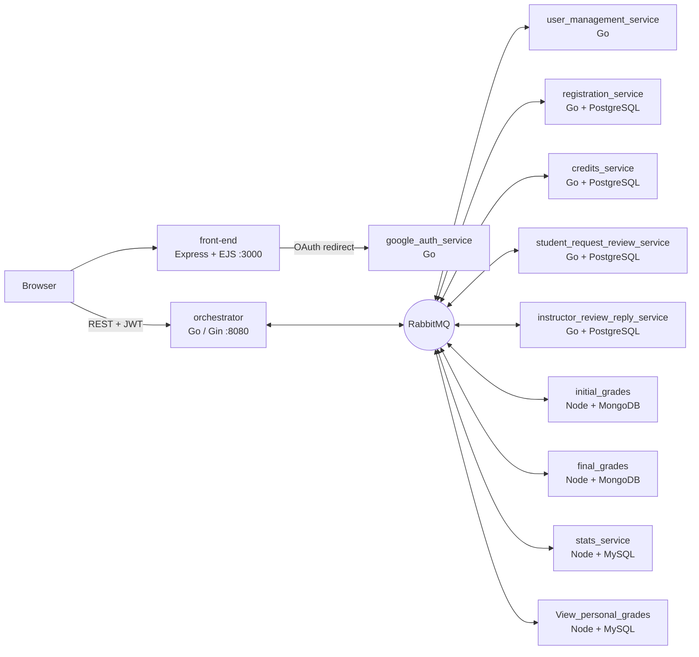

# clearSKY: Grade Management SaaS

A microservices SaaS platform where universities publish exam grades, students view their grades and request reviews, and instructors handle those reviews. Institutions pay for the service with credits.

Team project for **SaaS 2025** at the School of Electrical & Computer Engineering, National Technical University of Athens (NTUA), Team 12.


---

## My role: front-end developer

I built and maintained most of the front-end: 49 of the 59 commits in [`front-end/`](front-end). I also worked on the API gateway and the user service so the UI could talk to the backend.

- **Web app (Node.js + Express + EJS):** server-side rendered UI with session-based, role-aware routing for the three user types (student, instructor, institution representative). It has about 20 views and shared partials (header, role-specific navbars, flash messages).
- **API client layer:** ES-module wrappers in [`front-end/public/api/`](front-end/public/api) around a generic `request()` helper. The helper attaches the JWT, serializes JSON, query strings and `FormData` uploads, and normalizes errors.
- **Authentication flows:** sign-up, login and logout pages, plus the **Google OAuth** redirect and callback proxy to the auth service.
- **Grade statistics:** interactive grade-distribution charts built with **Apache ECharts**, for students, instructors and institutions.
- **Instructor & institution tools:** XLSX upload of initial and final grades, the review-request inbox and reply form, buying credits, registering institutions and managing users.
- **Student tools:** personal grades per course, review requests and their status.
- **Containerization:** the front-end Dockerfile and its integration into the root `docker-compose.yml`.
- **Backend glue:** routes and handlers in the Go **orchestrator** (Gin), and changes to the **user management service**, to expose the endpoints the UI needs.

---

## Features by role

| Role | Capabilities |
|---|---|
| **Student** | View courses and personal grades, request a grade review, track review status, view course statistics |
| **Instructor** | Upload initial and final grade sheets (XLSX), see review requests, reply to students, view statistics |
| **Institution representative** | Register the institution, buy credits, manage users, view statistics |

---

## Architecture

The browser talks only to the **front-end** (Express/EJS) and the **orchestrator**, a Go/Gin API gateway that validates JWTs and enforces roles. The orchestrator talks to each microservice asynchronously over **RabbitMQ**. Every service owns its database.



---

## Running locally

Requirements: Docker and Docker Compose.

```bash
git clone https://github.com/DimitriosLiakis/clearsky-grading-saas.git
cd clearsky-grading-saas
docker compose up --build
```

- Front-end: http://localhost:3000
- Orchestrator API: http://localhost:8080
- RabbitMQ management UI: http://localhost:15673

> **Configuration:** the `.env` files with credentials are not part of this public repository. Before you start, create a `.env` file in the repository root and in `google_auth_service/`. They need `JWT_SECRET`, `DATABASE_DSN`, `RABBITMQ_URL` and, for Google sign-in, your own `GOOGLE_CLIENT_ID` and `GOOGLE_CLIENT_SECRET` from the Google Cloud Console.

---

## Repository layout

```
front-end/                       Express + EJS web app (views/, public/js/, public/api/)
orchestrator/                    Go/Gin API gateway (JWT auth, role-based routes)
user_management_service/         Users, login, password management (Go)
google_auth_service/             Google OAuth 2.0 sign-in (Go)
registration_service/            Institution registration (Go + PostgreSQL)
credits_service/                 Credit purchases and balance (Go + PostgreSQL)
student_request_review_service/  Student review requests (Go + PostgreSQL)
instructor_review_reply_service/ Instructor replies (Go + PostgreSQL)
initial_grades/, final_grades/   XLSX grade import (Node + MongoDB)
stats_service/                   Grade distributions (Node + MySQL)
View_personal_grades/            Per-student grade view (Node + MySQL)
architecture/                    UML models (Visual Paradigm)
```

---

## Team

Built by Team 12 of the NTUA ECE SaaS 2025 course. See [contributors](../../graphs/contributors) for each member's work.
